# Awesome Social Media Marketing & AI Outreach 🚀

  

  
  
  
  
  
  

---

## 🎯 Overview & Scope

Welcome to the definitive, SEO-optimized directory of **Social Media Marketing (SMM) platforms**, **AI outreach automation tools**, and **high-star open-source GitHub projects**. Whether you are looking to scale brand reach via enterprise social suites, trigger autonomous AI agents for zero-API social discovery, or self-host your own privacy-first multi-network scheduling stack without monthly per-seat licensing fees, this ecosystem index covers every layer of modern social growth engineering.

### 🔍 Key Capabilities Covered
- 📅 **Multi-Channel Scheduling & Queue Management**: Cross-post across X (Twitter), LinkedIn, Instagram, TikTok, Facebook, Threads, YouTube, Pinterest, Bluesky, and Mastodon.
- 🤖 **Agentic Outreach & Social Automation**: Deploy autonomous AI agents to search discussions, draft hyper-relevant replies, and monitor community trends.
- 📡 **Social Listening & Brand Intelligence**: Track brand mentions, sentiment shifts, competitor campaigns, and keyword signals in real time.
- 🔗 **Link Attribution & Bio Management**: Track UTM conversion funnels, custom branded short domains, and self-hosted link-in-bio portals.
- 🔓 **Self-Hosted & Fair-Code Stacks**: Eliminate costly seat subscriptions using active open-source marketing software.

---

## 📊 Sector Overview & Market Dynamics

The global **Social Media Management Software (SMMS) market** is valued at approximately **$33.4 billion to $39.1 billion in 2026** (scaling from ~$29.9B in 2025 at an accelerating CAGR of **17% to 24%**), driven by rapid generative AI adoption, omnichannel marketing workflows, and real-time social listening demands. The sector is **moderately fragmented yet increasingly polarized**: established enterprise juggernauts (such as Sprinklr, Hootsuite, and Sprout Social) command large enterprise budgets with consolidated CRM and Unified-CXM suites, while hundreds of agile SaaS challengers and vibrant open-source developer toolkits capture developer advocates, indie hackers, and SMBs seeking transparent pricing and self-hosted infrastructure.

---

## 📑 Table of Contents

- [🎯 Overview & Scope](#-overview--scope)
- [📊 Sector Overview & Market Dynamics](#-sector-overview--market-dynamics)
- [🏢 SaaS & Hosted Social Media Platforms](#-saas--hosted-social-media-platforms)
- [💻 Open-Source GitHub Projects](#-open-source-github-projects)
- [🤝 How to Contribute](#-how-to-contribute)
- [💖 Support & Sponsorship](#-support--sponsorship)
- [📈 Star History](#-star-history)
- [⚖️ Disclaimer](#️-disclaimer)

---

## 🏢 SaaS & Hosted Social Media Platforms

*The table below compares leading hosted social media marketing platforms, ranked in descending order by company size (valuation / estimated market capitalization / annual revenue).*

| Platform | Pricing (Starting Tier) | Free Tier Limits / Free Trial Details | Company Size (Valuation / Market Cap / Revenue) | Key Strengths & Target Use Case |
| :--- | :--- | :--- | :--- | :--- |
| **[Hootsuite](https://hootsuite.com)** | **$99/month** (Standard plan, billed annually; 1 user, 10 social profiles) | **14-day free trial**; no credit card required upfront; daily posting limits (~10–20 posts/day) during trial; bulk scheduling disabled | **~$1.0B Valuation** (~$400M ARR; privately held market leader) | Multi-network enterprise publishing, social listening streams, team approval workflows, and AI caption generation. |
| **[Emplifi](https://emplifi.io)** | **$1,249/month** (Essential tier, annual billing for enterprise CX/social) | **No perpetual free tier**; trials require direct enterprise sales demonstration and custom pilot configuration | **~$1.0B Valuation** (Formed via Socialbakers & Astute merger, backed by Audax/Rubicon) | Enterprise unified customer experience (CX), AI publishing, omnichannel community moderation, and social commerce. |
| **[Sprout Social](https://sproutsocial.com)** | **$199/user/month** (Standard plan, billed annually; or $249/user/month monthly) | **30-day free trial** of full Professional tier; no credit card required upfront; access to core publishing and social reporting tools | **~$700M Market Cap** (NASDAQ: SPT; ~$480M–$491M TTM revenue in 2026) | All-in-one corporate social media management, social listening, influencer tracking, and enterprise team workflows. |
| **[Brandwatch](https://brandwatch.com)** | **~$833/month** (~$10,000–$14,000/year starting rate card; median enterprise contract ~$50,000/year) | **No self-serve free plan**; custom product demo and sales-assisted guided sandbox environment on request | **$450M Valuation** (Acquired by Cision for $450M; $50M+ annual revenue) | Enterprise consumer intelligence, deep-web social listening, and sentiment analytics across billions of historical posts. |
| **[Later](https://later.com)** | **$18.75/month** (Starter tier billed annually at $225/yr; or $25 month-to-month) | **14-day free trial** across paid tiers (unlocks 1 Social Set of 8 profiles, 30 scheduled posts/profile/mo, 5 AI credits/mo; credit card required) | **$2.4B+ GMV Run Rate** (Privately held, acquired Mavely; high double-digit YoY growth) | Visual content calendar, Instagram/TikTok aesthetic planner, link-in-bio builder, and creator commerce monetization. |
| **[Agorapulse](https://agorapulse.com)** | **$79/user/month** (Standard tier billed annually; or $99/user/month monthly; 10 profiles) | **30-day free trial** (no credit card required upfront); basic restricted free tier available for 1 user, 3 profiles, and 10 scheduled posts | **~$20M ARR** ($18M in total private venture funding raised; privately held) | Unified multi-channel social inbox, social ROI attribution reporting, listening streams, and publishing queue. |
| **[Buffer](https://buffer.com)** | **$5/channel/month** (Essentials plan billed annually; or $6/channel/month monthly) | **Free-forever plan**: up to 3 connected social channels, max concurrent queue limit of **10 scheduled posts per channel**, 1 user, includes AI Assistant and 30-day basic analytics | **~$28.8M ARR** (Profitable, bootstrapped private SaaS with ~80,000+ paying customers) | Clean, friction-free scheduling, content planning, and analytics toolkit popular with solo creators, indie hackers, and lean teams. |
| **[Sendible](https://sendible.com)** | **$30/month** (Core plan billed annually; or $35 month-to-month; includes 1 workspace & 6 profiles) | **14-day free trial** on all standard plans; no credit card required upfront; full access to multi-network publishing and reporting | **~$6M–$8M ARR** (Privately held UK-based SaaS company; bootstrapped/SMB agency focused) | Social media management built specifically for marketing agencies with white-label client portals and approval queues. |
| **[Loomly](https://loomly.com)** | **$32/month** (Base plan billed annually at $384/year; or $42 month-to-month; 2 users, 10 profiles) | **15-day free trial** across all subscription tiers; no credit card required upfront; access to content calendar and post idea tips | **Privately Held SMB SaaS** (Profitable boutique brand management tool with tens of thousands of active teams) | Collaborative brand calendar platform offering post optimization suggestions, multi-tier approvals, and content asset libraries. |
| **[SocialPilot](https://socialpilot.co)** | **$25.50/month** (Essentials plan billed annually at $306/year; or $30 month-to-month; 1 user, 7 profiles) | **14-day free trial**; no credit card required upfront; unlocks bulk post scheduling, content curation feeds, and analytics reports | **Privately Held SMB SaaS** (Fast-growing global marketing platform with 13,000+ agency and business customers) | High-volume social media scheduling, bulk queuing via CSV, client management workflows, and white-label agency analytics. |

---

## 💻 Open-Source GitHub Projects

*The table below features the most active, high-impact open-source tools for social media scheduling, AI agent outreach, social listening, link attribution, and marketing automation. Entries are sorted in descending order by GitHub stargazers count, with real-time social badges linking directly to their stargazers page.*

| Project & Repository | GitHub Stars Badge | Tech Stack / Architecture | Core Focus & Description |
| :--- | :--- | :--- | :--- |
| **[n8n](https://github.com/n8n-io/n8n)** |  | TypeScript, Node.js, Vue | Fair-code workflow automation engine with native AI agent nodes, pre-built social connectors (X, LinkedIn, Telegram, Discord, Mastodon), and autonomous marketing webhooks. |
| **[Ollama](https://github.com/ollama/ollama)** |  | Go, C/C++ | Local LLM runtime to power private, zero-API-cost social copy generation, tone adaptation, sentiment classification, and automated DM reply pipelines. |
| **[Open WebUI](https://github.com/open-webui/open-webui)** |  | Python, Svelte, TypeScript | Extensible, self-hosted AI interface with pipeline plugins and web-search capabilities for drafting viral hooks, audience research, and multi-model social generation. |
| **[Agent-Reach](https://github.com/Panniantong/Agent-Reach)** |  | Python, Node.js, MCP | Zero-API-fee autonomous outreach toolkit and MCP skill empowering AI agents (Claude Code, Cursor, OpenClaw) to search, read, and engage on X, Reddit, YouTube, Xiaohongshu, and LinkedIn. |
| **[Twenty](https://github.com/twentyhq/twenty)** |  | TypeScript, NestJS, React | Modern, open-source CRM built for the AI era; ideal for syncing social engagement leads, outreach attribution, and customer relationships. |
| **[Mastodon](https://github.com/mastodon/mastodon)** |  | Ruby on Rails, React, Redis | The leading self-hosted decentralized social networking platform powered by ActivityPub; foundational for decentralized brand presence and fediverse community building. |
| **[RSSHub](https://github.com/DIYgod/RSSHub)** |  | Node.js, TypeScript | Extensible RSS feed generator that turns virtually any social media profile, tag, or discussion (X, Bilibili, Reddit, Instagram, Telegram) into structured streams for social listening. |
| **[Postiz](https://github.com/gitroomhq/postiz-app)** |  | TypeScript, Next.js, Prisma | Open-source agentic social media scheduling dashboard supporting X, LinkedIn, Instagram, TikTok, YouTube, Reddit, Threads, and Bluesky with built-in AI generators and analytics. |
| **[Novu](https://github.com/novuhq/novu)** |  | TypeScript, React, NestJS | Open-source notifications and communication engine bridging outreach alerts across email, SMS, push, in-app feeds, and social chat platforms. |
| **[Chatwoot](https://github.com/chatwoot/chatwoot)** |  | Ruby on Rails, Vue | Omnichannel customer communication and social inbox alternative to Intercom/Zendesk; connects Twitter/X DMs, Facebook Messenger, WhatsApp, and website live chat. |
| **[Umami](https://github.com/umami-software/umami)** |  | TypeScript, Next.js, Prisma | Lightweight, privacy-focused open-source analytics platform for tracking visitor conversions, outbound clicks, and traffic generated from social outreach campaigns. |
| **[ChangeDetection.io](https://github.com/dgtlmoon/changedetection.io)** |  | Python, Playwright, Flask | Self-hosted webpage change detector and social monitoring sentinel with MCP support; sends instant webhook notifications and AI summaries when competitor social pages change. |
| **[Plausible Analytics](https://github.com/plausible/analytics)** |  | Elixir, Phoenix, ClickHouse | Simple, cookie-less, lightweight web analytics engine for verifying campaign ROI, referral sources, and visitor behaviors from social links. |
| **[Crawlee](https://github.com/apify/crawlee)** |  | TypeScript, Node.js, Playwright | Web crawling and browser automation framework with smart anti-bot avoidance for building custom social scrapers, sentiment analyzers, and lead enrichment pipelines. |
| **[Dub.link](https://github.com/dubinc/dub)** |  | TypeScript, Next.js, TailwindCSS | Modern link management and attribution engine with deep click analytics, geo-targeting, QR code creation, and UTM tracking for social campaigns. |
| **[Listmonk](https://github.com/knadh/listmonk)** |  | Go, React, PostgreSQL | Blazing fast, self-hosted newsletter and mailing list manager to convert social media followers and engaged viewers into owned email audiences. |
| **[Bluesky Social App](https://github.com/bluesky-social/social-app)** |  | TypeScript, React Native, Expo | Official client application for Bluesky and the decentralized AT Protocol; critical reference codebase for building automated AT Protocol bots and schedulers. |
| **[Mautic](https://github.com/mautic/mautic)** |  | PHP, Symfony, MySQL | The world's largest open-source marketing automation platform featuring social monitoring, multi-channel campaign builders, lead scoring, and automated drip sequences. |
| **[Shlink](https://github.com/shlinkio/shlink)** |  | PHP, Swoole, Mezzio | Self-hosted, lightweight URL shortener with REST API, multi-domain support, QR codes, and detailed visit tracking for custom marketing links. |
| **[LinkStack](https://github.com/LinkStackOrg/LinkStack)** |  | PHP, Laravel, Bootstrap | Self-hosted, customizable link-in-bio platform offering total privacy, custom themes, and link tracking without third-party fees. |
| **[Mixpost](https://github.com/inovector/mixpost)** |  | PHP, Laravel, Vue.js, Inertia | Self-hosted social media management suite (self-hosted Buffer alternative) offering calendar scheduling, multi-account publishing, and analytics with zero subscription fees. |
| **[LittleLink](https://github.com/sethcottle/littlelink)** |  | HTML5, CSS3, Minimalist JS | Ultra-lightweight, customizable open-source alternative to Linktree with 100+ branded social media buttons and zero external runtime dependencies. |
| **[Socioboard](https://github.com/Socioboard-developers/Socioboard-5.0)** |  | C#, .NET Core, Angular | Open-source enterprise social technology enabler offering multi-channel social management, automated publishing queues, and content discovery. |

---

## 💡 Architecture Playbook: Building a 100% Autonomous Outreach Stack

To launch a production-grade, self-hosted social marketing and AI engagement engine with zero SaaS seat overhead:

1. **Scheduling & Publishing Layer**: Deploy **[Postiz](https://github.com/gitroomhq/postiz-app)** or **[Mixpost](https://github.com/inovector/mixpost)** for multi-account calendar visualization and asset queuing.
2. **Autonomous Social Intelligence**: Integrate **[Agent-Reach](https://github.com/Panniantong/Agent-Reach)** with **[RSSHub](https://github.com/DIYgod/RSSHub)** to listen for niche keywords across X, Reddit, and LinkedIn without paying costly API fees.
3. **Local AI Agent Generation**: Run **[Ollama](https://github.com/ollama/ollama)** locally to classify post sentiment, verify relevance, and draft authentic discussion replies.
4. **Orchestration & Verification**: Connect pipeline stages inside **[n8n](https://github.com/n8n-io/n8n)** with a human-in-the-loop review queue on Telegram or Slack before dispatching live posts.
5. **Attribution & Traffic Funnels**: Wrap all outbound URLs through **[Dub.link](https://github.com/dubinc/dub)** or **[Shlink](https://github.com/shlinkio/shlink)** and measure actual conversions using **[Umami](https://github.com/umami-software/umami)**.

---

## 🤝 How to Contribute

Contributions are warmly encouraged! Help keep this directory current, accurate, and valuable for the open-source community:

1. 🍴 **Fork the repository**.
2. 🌿 **Create a descriptive feature branch** (`git checkout -b feature/add-new-social-tool`).
3. 📝 **Add or update entries** following the tabular format above. Ensure you include:
   - Specific starting price tier (no generic text).
   - Specific free tier limits or free trial terms.
   - Company scale / market valuation context (for SaaS).
   - Active repository link with stargazers badge (for OSS).
4. ✅ **Ensure links are valid and descriptions remain objective**.
5. 🚀 **Submit a Pull Request** with a clear explanation of your changes.

---

## 💖 Support & Sponsorship

If you find this curated directory helpful for your business, research, or development stack, please consider supporting the project:

- ⭐ **Star this repository** to help other developers discover it!
- 🍴 **Fork and share** it across your social and developer communities.
- ☕ **Buy a coffee or sponsor ongoing development**: Support via the [GitHub Sponsor Dashboard](https://github.com/sponsors/ishandutta2007).

Your backing ensures these listings remain updated with the latest tools, pricing revisions, and architecture patterns!

---

## 📈 Star History

---

## ⚖️ Disclaimer

- This repository is a **community-curated index** provided for educational, research, and technical evaluation purposes only. Inclusion does not imply official endorsement.
- All outreach, scraping, and automated engagement activities must strictly comply with individual platform Terms of Service (ToS), rate limits, and regional privacy regulations (GDPR, CAN-SPAM). Always implement human-in-the-loop safeguards when deploying automated bots.
- When self-hosting applications, always safeguard credentials, API keys, and session cookies in encrypted environment variables.

---

  <b>Built with ❤️ for indie hackers, growth engineers, social media managers, and AI builders.</b> 
  Keeping social media outreach open, transparent, and accessible to everyone.

